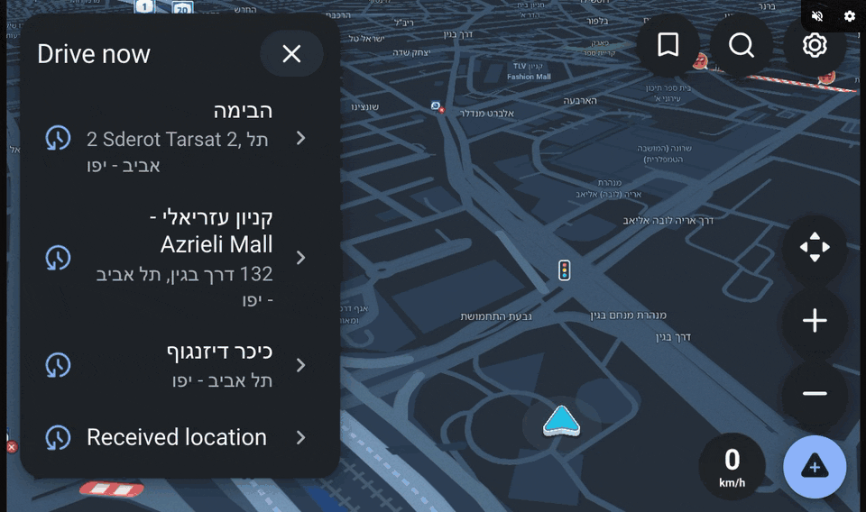
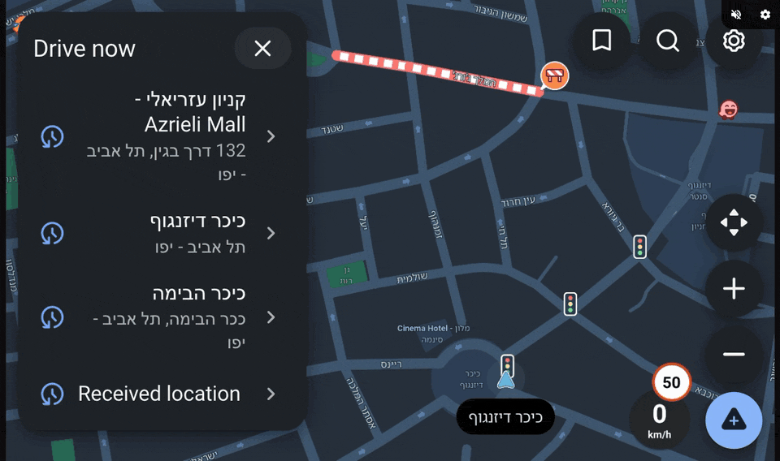
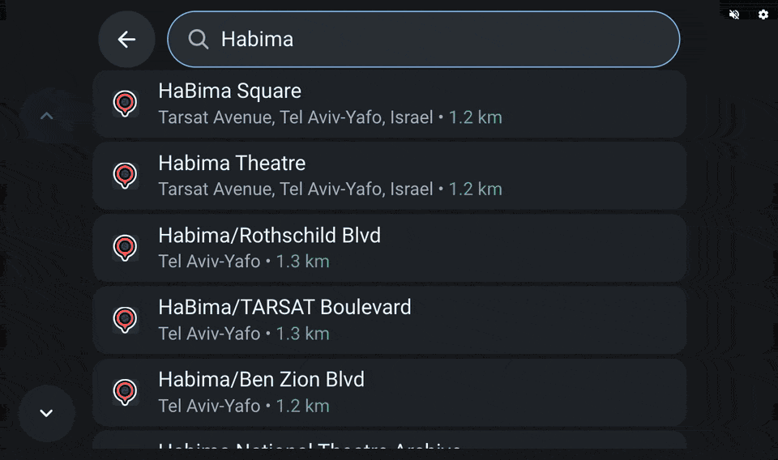
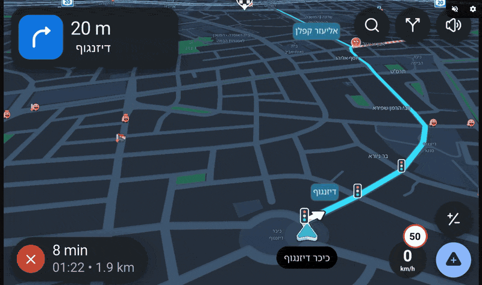
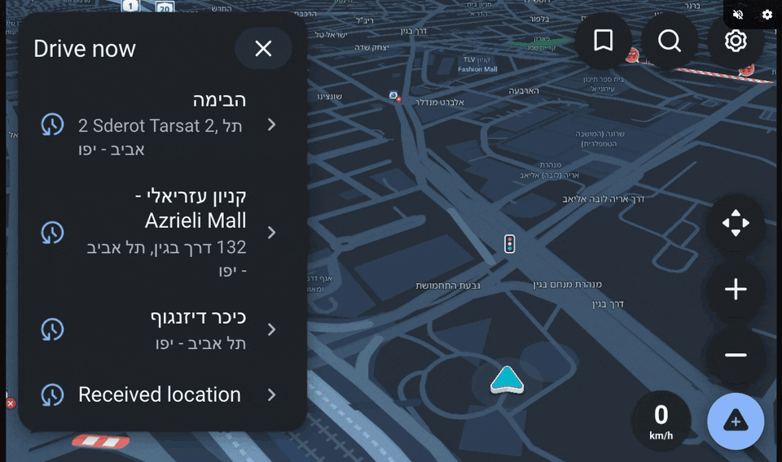
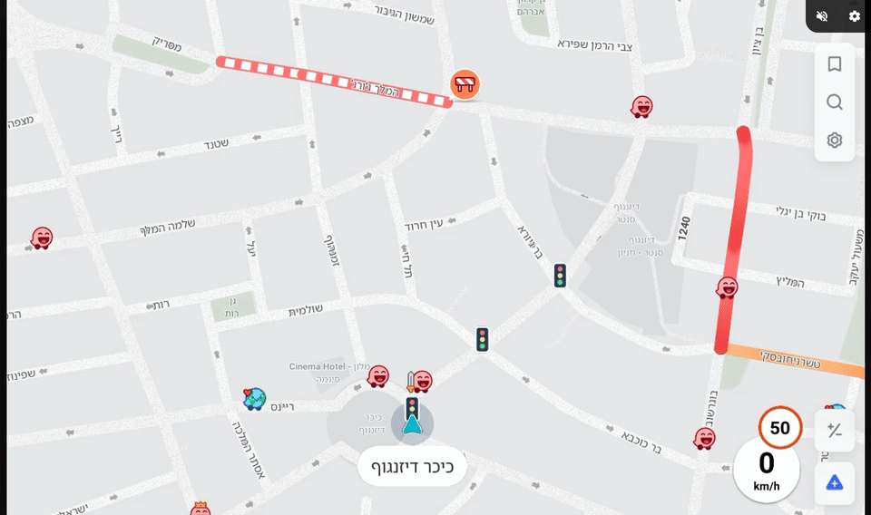
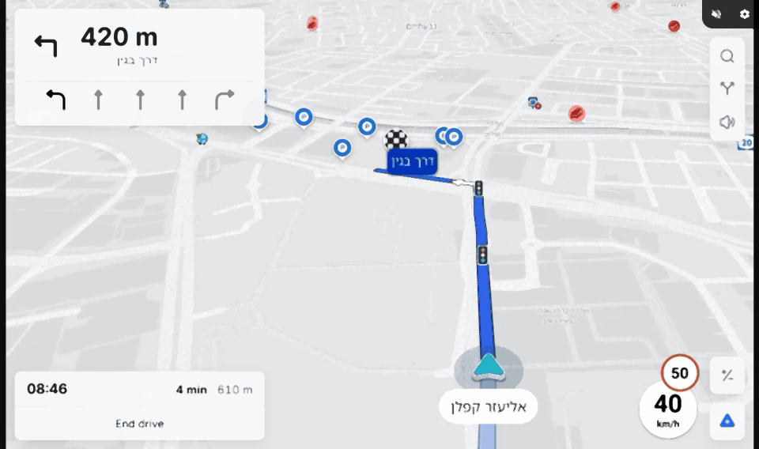
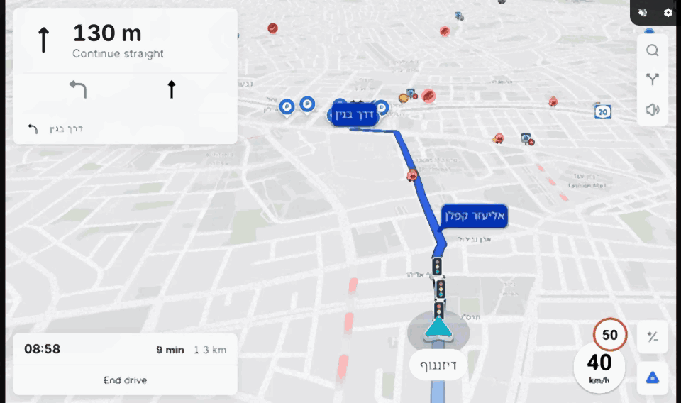

# Changelog

All notable changes to teslalinux, newest first. The format follows
[Keep a Changelog](https://keepachangelog.com/en/1.1.0/) and the versions follow
[Semantic Versioning](https://semver.org/).

<!--
This file is the one source of the release notes:
- the car page's Release Notes (web/js/release-notes/release-notes-data.js) are generated from it by
  `python3 tools/changelog/changelog.py page`, and tools/debvm/pack-dist.sh refuses to pack a stale
  copy;
- the GitHub Release of a tag v* is the section of that version (.github/workflows/release.yml).
Each "### Topic" is one card on the car page; its first line, in italics, is the card's subtitle.
"### Platform" is for developers and stays off the car page. Images are shown on GitHub only.
Date a version's heading ("- YYYY-MM-DD" instead of "- Unreleased") when its tag is pushed.
Changes not in a release yet go under "## [Unreleased]" (the car page shows it as "Unreleased")
until that section becomes the next version's.
-->

## [Unreleased]

### Open PalGate gates from the car

*Settings > Gates, and a gate button on the map in both interfaces.*

- Link the device to your PalGate account once: Settings > Gates shows a code, and the PalGate
  app on your phone scans it (Device Linking > Link a Device). The PalGate app does not run on the
  device; it opens your gates the way the app's linked devices do.
- A gate button stands next to the settings and sound buttons. With one gate shown it opens that
  gate at once; with more it lists them, one tap each. You see it being sent, then opened, or why
  it did not open.
- Choose which gates the button shows, their order, their names, and which output a two-output
  gate opens.
- Open on arrival, per gate and off until you turn it on: take the gate's position from the car,
  then it opens when the car comes into the circle around it from outside, driving towards it at
  a speed you set, and not again until the car has left and the cooldown has passed. A notice on
  the map says when it did.
- Your PalGate phone number and link stay on the device, readable by its service only.

### Waze keeps your position in tunnels with beacons

*Both interfaces. Uses the Pi's own Bluetooth (or a USB Bluetooth adapter).*

- Tunnels such as Boston's I-93, New York's Lincoln, Holland, Queens-Midtown and
  Brooklyn-Battery or Chicago's Lower Wacker Drive have Waze Beacons: small Bluetooth transmitters
  that tell Waze where the car is when GPS cannot reach it. Waze now hears them, as on a phone,
  so the car's arrow keeps moving through the tunnel.
- Bluetooth is turned on for this; it does not make the device start any later. Waze only
  listens near tunnels that have beacons, and Waze may only listen: it cannot pair with or connect
  to anything.

### New settings and sound buttons on the map

*Both interfaces, both looks, day and night.*

- The settings and sound buttons are no longer a small black tab squeezed into the top right
  corner. They are map buttons like Waze's own on the car screen: round and dark with the
  Rounded look, a frosted tile with Graphite, the same size as Waze's map buttons and lined up
  with them, never smaller than a fingertip.
- They never cover Waze's buttons, the directions or a card: on a narrow screen, such as a
  phone's, the cards start below them, and full-screen lists and search end before them.
- The settings button now shows sliders, so it is not mistaken for Waze's own settings gear.

### Typing while driving, for a passenger

*Car mode. Settings > Waze > While driving > Typing while driving.*

- Off (the default) is as in Android Auto: while the car moves the search field takes no typing,
  and voice search still works. On lets a passenger type a destination while the car moves; lists
  stay as short as before.
- It applies at once, without restarting Waze, on every screen showing Waze, and stays on after a
  restart. Typing while driving is the driver's responsibility: turn it on for a passenger.

### See the car's screen on a computer

*Settings > This device > Debug.*

- "Emulate the Model 3 screen" shows this page on a computer exactly as a Model 3's browser shows
  it: its window size and pixel density, the picture size it asks the Pi for and its sharpness,
  scaled to fit the window or one car pixel per screen pixel. A bar above it says the emulation
  is on, with a button to stop. It is for this browser only.

### Map frame rate: Automatic

*Car mode. Settings > Waze interface > Map frame rate. Measured on a Raspberry Pi 4 at its standard
speed, on a road route.*

- New default: **Automatic**. Waze's map draws up to 60 pictures a second while it moves (while
  you drive, pan or zoom, or use the car screen's buttons and lists) and Waze's own 30 while it is
  still. While driving it is as smooth as Full (about 47 pictures a second at the standard size);
  standing still it needs half the Pi's processor and graphics time that Full does, the same as
  Waze's own rate. A few seconds after the car stops, the map goes back to 30.
- Three choices now: Automatic, Waze's own (30 a second) and Full (up to 60 all the time). A Pi
  that already had Waze's own or Full chosen keeps it. Automatic, like Full, works with the Waze
  version the device has checked (5.27.5); with another version Waze keeps its own rate, and the
  setting says so.

### Waze starts in seconds after a mode change

*Both interfaces. Measured on a Raspberry Pi 4 at its standard speed.*

- Switching between the phone and car interfaces, or changing Map frame rate, no longer prepares
  Waze's code all over again: Waze is back on the map in about 6 seconds (9 in the phone
  interface) instead of about 2 minutes.
- After an install or an update, the code is prepared once during the install (about 2 minutes on
  a Pi 4), and the first start in the car then takes about 6 seconds instead of 2 more minutes.

### The car screen says what Waze is doing while it starts

*Both interfaces, day and night.*

- While Waze is not on the screen yet, the car screen says whether Waze is being prepared for this
  device (once, after an update or a mode change), starting, or restarting after it stopped,
  instead of a dark screen.
- While Waze is being prepared, a bar shows how far along it is and about how long is left,
  measured from the last time on this device (the first time it says that it takes a few
  minutes), with the steps that follow. It goes away as soon as Waze draws its map.

### Waze's own settings in Settings

*Car mode. Settings > Waze > Waze's settings.*

- Waze's car settings now appear in the settings page itself, exactly as Waze offers them and in
  Waze's language: roads to avoid, toll and HOV passes, vehicle type, sound, privacy, your account
  and the rest. Switches, choices and sub-pages work as in Waze, and every change goes straight to
  Waze, so they stay right whatever Waze version is installed.
- Leaving the settings page puts Waze back on its map. If Waze is asking something on the map at
  that moment, the group says so: answer it there first.
- While Waze guides you it offers no way to its settings (on the car screen too), and while a
  question or a list is on its map neither. The group now says which, opens Waze's settings by
  itself as soon as Waze offers them again, and during a drive offers to end it.
- Closing the car page (or the browser) while Waze's settings are open also puts Waze back on its
  map, at once; when the car simply drives out of the Wi-Fi's range, within about half a minute.
  Before, Waze's settings stayed on the car's map.
- Long lists on the car screen (Waze's settings, search results) no longer start under their page
  arrows on a narrow screen ("ccount" instead of "Account").

### The speedometer on the car screen

*Car mode, both looks, day and night. Settings > Waze interface > Speedometer.*

- The speedometer is now drawn by the car screen instead of inside Waze's map: the current speed
  in a bubble and the road's speed limit as a road sign beside it, at the bottom right next to the
  map buttons. It follows the look (Rounded or Graphite), day and night, and Panel size. The speed
  turns red above the limit, as in Waze; speeds are in miles where Waze uses miles, with the US
  speed limit sign where Waze shows that one.
- Settings > Waze interface > Speedometer: Speed and limit (the default), Limit only, or Off; and
  Speedometer position: bottom right (the default) or under the directions at the top left.
- This needs a Waze version the device has checked (now 5.27.5). With any other version Waze keeps
  drawing its own, and the setting says so. In the phone interface Waze's own speedometer is back.

### The car's keyboard by default, voice search off

*Settings > Waze > Keyboard and Settings > Sound > Voice search button.*

- Typing into Waze now uses the car's own keyboard by default (also a phone's, when the page is
  open on one), and the car's keyboard has a microphone for dictating a place. Waze's built-in
  keyboard is still there: turn "Use this device's keyboard" off. A Pi that already has a choice
  keeps it.
- The microphone button in the car interface's search is off unless switched on. It uses the
  browser's speech recognition, which a Tesla's browser does not have, so in the car it did
  nothing. The setting says so, and the voice language and the microphone test appear only when
  it is on. With it off, Waze is told that this page cannot recognise speech.

### Voice search in the phone interface

*Settings > Sound > Voice search button.*

- Waze's own microphone button in the phone interface works: with voice search switched on in this
  browser, a tap listens through the car page and Waze searches what was said.

### A new settings page

*Settings, in the car and on a phone, day and night.*

- Seven sections instead of eleven, by what you want to do: Overview, Waze, Display, Sound,
  Connections, Updates and This device. Each shows its state in the list on the left (for example
  "LTE, 4 of 5 bars" or "Up to date"), with a dot where something needs you.
- Overview tells at a glance whether the car is connected, the internet works, Waze has the car's
  position and is running, lists what needs you, and has the controls you change most.
- Bigger buttons and switches for the touchscreen; choices you can see at once instead of drop-down
  lists; language and time zone in a list you can filter. Every change says in its row whether it
  was saved, and a failure no longer empties the page.
- Changes that restart Waze wait in one bar at the bottom: change several, then restart Waze once,
  or undo them.
- Hotspot and LTE changes are collected until you apply them, now or at the next start.
- Search finds any setting by name or by what it does.
- This device shows how long the last start took: ready for the car after about 8 seconds on a
  Pi 4, and when Waze's map was ready, with the previous starts.
- The page follows the car interface's day and night. Release notes open from Updates > What's new.

### A smaller turn card

*Car mode, both looks, day and night.*

The card with the next turn took almost half the screen. It is now about a fifth shorter: a
smaller turn sign and lanes row, and the street name gets room for its two lines. The exit and road
signs Waze puts in front of a street name were drawn at the height of the letters, too small to
read; they now keep their own shape and are a little taller than the text.

### Map text size without a restart, sound on a Pi speaker

*Settings > Waze > Map text size in Car mode, and Settings > Sound.*

- Changing Map text size no longer makes Waze restart. Waze's map surface was replaced while the
  picture of its last frame still pointed at a closed buffer, which cut Waze off the display.
- Waze's voice on a speaker connected to the Pi: Settings > Sound > Where Waze's sound plays (Car,
  Pi speaker, Both), with its own volume. A USB sound card or speaker is used when plugged in, else
  the 3.5 mm jack; plugging in or out takes effect at once.

### Smaller fixes

*Things that were in the way.*

- In the phone interface, the vehicle picker (Car info on the map) drew its car, motorcycle and
  taxi pictures twice as large as on a phone: their names were missing, the blue
  frame around the chosen vehicle had no top, and the description bubble sat far below it. Waze's
  pictures are now drawn at their Android size everywhere, so the picker shows small pictures with
  their names, as on a phone. The row of vehicles repeating to the sides is Waze's own: it scrolls
  round endlessly, and the car's wide screen shows more of it than a phone does.

### Platform

#### Added

- `services/gates` (`teslalinux-gates.service`, loopback 8082 behind `/api/gates*`): PalGate's
  cloud API as a linked device (our own implementation of the request token, checked against
  published vectors), a stdlib QR encoder, per-gate auto-open from the GPS feed, an events long
  poll; tests against a local mock of the API (`services/gates/test/`); `docs/GATES.md`. Needs
  `python3-cryptography` (`py3-cryptography` on Alpine), now in the install package lists.
- Bluetooth for the apps (`docs/BEACONS.md`): the Pi 4 keeps its controller (no `disable-bt`),
  `bluez` is installed and `bluetooth.service` enabled, a saved rfkill soft block is lifted, and
  `/etc/dbus-1/system.d/teslalinux-bluetooth.conf` allows the `tesla` user only BlueZ's discovery
  calls. Measured on a Pi 4: hotspot and car page no later than without Bluetooth.
- `tools/debian/atl-tests/bluetooth/`: BluetoothTest against a mock bluetoothd on a private bus
  (`run.sh`, 80 checks), `run.sh --live` on a real adapter, and `eddystone-adv.sh`, which makes a
  BlueZ host advertise Waze-format Eddystone UID and TLM frames.

In ATL (the fork):

- Bluetooth LE scanning as on Android, over BlueZ's D-Bus API (fork track bt): the adapter and
  its state broadcasts, `BluetoothLeScanner` with filters, callback types, batching,
  opportunistic scans and AOSP's error, permission and location rules, the legacy `startLeScan`,
  remote devices from BlueZ; no Bluetooth at all without BlueZ or with `ATL_BLUETOOTH=off`.
- OpenGL apps get the whole Android GL API: every `android.opengl.GLES10`-`GLES32` call and the
  GL10/GL11 interface of GLSurfaceView renderers (AOSP's own bindings), with KHR_debug's message
  callback and log. Apps can draw into a `SurfaceTexture` with a `Canvas` (`Surface.lockCanvas`),
  also with `ATL_DIRECT_EGL`. The Android keystore makes RSA and EC key pairs with their
  certificate, signs, decrypts, agrees ECDH keys and imports keys as Android does on a device
  without secure hardware or attestation keys.
- Android apps see the real audio outputs: the car, a USB sound card, the 3.5 mm jack, and are
  told when one is plugged in or out (`AudioManager` devices from PipeWire's pulse server through
  libpulse, with AOSP's device types, `AudioDeviceCallback`s and `AUDIO_BECOMING_NOISY`).
- Drawing is closer to Android: every colour-filter blend mode (tints with screen, add, overlay,
  ...), hairlines that stay one pixel wide when scaled, translucent fill-and-stroke shapes, rounded
  and bevelled rectangle corners, and `Paint.getFillPath`. Apps that support right-to-left
  languages now get mirrored layouts when their language is RTL (AOSP's layout direction
  resolution, relative padding and alignment, and the RTL rules of `LinearLayout`,
  `RelativeLayout`, `GridLayout` and `ExpandableListView`).
- The app now sees the car's real connection: an LTE stick shows as cellular and metered, and
  Wi-Fi or Ethernet as unmetered, with live updates when it changes (from NetworkManager and
  ModemManager). Apps get exactly the permissions they ask for (the manifest's, by protection
  level; `AppOpsManager` follows them). The Android keystore enforces how each key may be used.
  Video and GL apps can stream into textures (`SurfaceTexture`), and frames with a presentation
  time (`eglPresentationTimeANDROID`) are shown on time. Storage usage (`StorageStatsManager`) and
  frame timing (`Choreographer` frame data) are now real values.
- The car-app host passes the app's speedometer to the car page (`ATLCarSpeedometer`, the
  channel's `speedometer` message, docs/UPSTREAM-NOTES.md). `tools/apps/waze-speedometer.py` makes
  verified Waze versions' own reading class a subclass of it (a one-class override generated on
  the device after checking the APK's class and its call site) and turns Waze's map speedometer
  off through its own setting, kept and put back in the phone interface.
- `ATLFrameRateLimiter`: a frame limiter for an app's own render loop that lets frames come at the
  display's refresh rate for 5 s (`ATL_FRAME_BOOST_MS`) after ATL saw the content move (a location
  fix of a moving device, a touch on the car-app host's map, a message from the car renderer, a
  different car template), the app's own rate and boosts otherwise (`ATL_DEBUG_FRAME_RATE=1` logs
  the rate in effect). `tools/apps/waze-map-pacing.py --mode auto` makes a verified Waze version's
  frame limiter class (`com.waze.bq.a`) a one-class override extending it, after checking the
  class's code instruction by instruction and every reference to it in the APK's dexes;
  `TESLALINUX_MAP_PACING=auto|app|full` (auto when unset), `/api/appInterface` `mapPacing` and
  `mapPacingSupport.modes`. The generated override jars keep their dex 4-byte aligned, so ART maps
  it instead of extracting a copy.
- Bitmap pixel access as Android (un-premultiplied colours, setPixels replaces, exact buffer
  copies, the NDK bitmap API on the pixel memory) and GLUtils; Gouraud-shaded
  drawVertices/drawBitmapMesh; the expanding clip ops for apps targeting API 27; the Matrix
  operations that had no native code.
- View accessibility delegates and event dispatch; the hover, generic motion, drag, system UI and
  unhandled-key listeners; PathInterpolator(Path) and pathData; PropertyValuesHolder keyframes,
  evaluators (ArgbEvaluator colour animations) and Path animations; getCurrentLocation as Android;
  a requested RECORD_AUDIO is granted while the car page offers speech recognition.
- libcore dexed with D8 (tools/debvm/patches/libcore-d8.py), so libcore's own lambdas
  (Comparator.comparing, Collectors.groupingBy, ...) work.
- The built-in on-screen keyboard is the window's IME inset (`WindowInsets.Type.ime()`, the
  activity resized for `adjustResize`, `WindowInsetsAnimation` callbacks with AOSP's dispatch
  modes); each window (a dialog, the activity) keeps its own focused view. Android's key character
  maps (`KeyCharacterMap` from Generic.kcm and Virtual.kcm, AOSP's parser); EGL surface queries and
  attributes as EGL 1.5 (`EGL_SWAP_BEHAVIOR`, buffer age, `eglGetError` per thread). The Java
  natives that had no C code: `Process`, `Trace`, `SystemClock`, `SQLiteConnection` blob file
  descriptors, `AssetManager`, `XmlBlock` and `StringBlock` (styled strings), `BitmapFactory`;
  `tools/debian/atl-tests/natives/` checks them.
- `tools/debian/pi-bench.py --procs NAME,... --gpu --per-second`: each process's CPU and V3D
  share (DRM fdinfo) over the measured seconds, and the frames of every second.
- One class path for every start: the launcher loads the speedometer and frame limiter overrides
  whatever the interface and Map frame rate (they are part of the app's class loader context, so a
  different list made ART compile Waze again), the frame rate is ATL's `ATL_FRAME_RATE` policy at run
  time (`boost`, `display`, `app`), `waze-map-pacing.py` makes only the limiter class (its whole-dex
  "full" copy is gone), and `teslalinux-atl --compile` compiles with the same overrides (ATL's
  `TlPrewarm`). `ClassLoaderContext ... mismatch` no longer appears after a switch.
- `GET /api/appState` `start` (and `?wait=SEQ` long polls): the app's start for the car page's
  overlay, from `host/teslalinux-app-log-watch.py` (the launcher's log filter, its state file in
  `/run/tesla`) and the app's dex2oat in /proc, whose CPU time against the last complete compile of
  the same file (`~/.cache/teslalinux/compile-times.json`) is its progress (dex2oat writes its
  output only at its end). `pi-bench.py` reports main-thread CPU (`cpu_main`).
- `tools/debian/carapp-probe.py`: the car-app channel from a shell: each template's class, screen
  stack and every action and row with its icon's resource name and callback; click, back, any
  message, and a socket that vanishes without a close frame.
- The car-app channel's `appSettings` message (docs/UPSTREAM-NOTES.md): the page says when it
  opens and closes Waze's settings, and on `pagehide`; the host pops abandoned settings back to the
  map itself, also when the page's socket closes or stays silent (the host pings every page every
  10 s and closes one silent for 30 s).

#### Fixed

- ATL's `AssetManager.destroy()` only logged "STUB", so no asset manager and no loaded APK was ever
  freed: every Context has a manager of its own, and a parsed package one more. The native manager
  is now deleted when its last reference goes or the object is finalized, and its APKs are released
  when no manager sharing them is left (a reference-counted set owning the strong reference
  `ApkAssets_load` hands out). Asset streams take a reference of their own and themes are deleted
  when released, as in AOSP; without the first, the first asset stream closed would have freed its
  manager. art_standalone's androidfw C API gains `AssetManager_delete` and `ApkAssets_release`
  (`tools/debvm/patches/art_standalone-androidfw-free.py`), which also stops `AssetManager_setApkAssets`
  leaking a list per call. Measured with 300 managers a round over framework-res.apk: the process
  grew about 560 MB a round, now not at all. `tools/debian/atl-tests/assets/` checks it (11 checks:
  streams, themes, sharing, memory).
- Right-to-left text in ATL's text views is aligned as Android aligns it: a Hebrew place name with
  the default alignment starts at the right, from the text's own direction (AOSP's text direction
  heuristics; they were placeholders), also when the view's layout is left to right.
- `Bitmap.copy` drew on the copy's blank snapshot, and a clip still pushed when a bitmap was read
  lost what was drawn before it. A KHR_debug message callback's global reference leaked when its
  GL context was destroyed. `new EditText(context)` skipped the theme's `editTextStyle`, so it was
  not focusable.
- ATL drew every bitmap resource (a PNG from an app's `drawable-<density>` directories) at its
  pixel size, whatever density it was made for: on the car's 245 dpi display, Waze's
  `drawable-xxhdpi` pictures came out twice as large as on Android. `Drawable.createFromResourceStream`,
  `BitmapFactory.decodeResource` and `<bitmap>` drawables now scale from the resource's density to
  the display's, as AOSP does (with a decode into `inBitmap` getting the scaled pixels), and
  `ImageView.setImageResource` resolves the drawable as AOSP does. `tools/debian/atl-tests/graphics`
  checks it (`run.sh`, 10 more checks).

## [0.3.1] - 2026-11-20

Graphite map colours for Waze 5.27, the version a new install gets.

### Graphite map colours on Waze 5.27

*Settings > Waze interface > Map colours > Graphite.*

The Graphite map colours were checked with Waze 5.25 only, so with Waze 5.27.5 the map kept Waze's
own colours. They are now checked with 5.27.5 too (day and night, on the map, while driving and in
the route overview) and apply to it. The route preview's bubbles and the position arrow still keep
Waze's own colours, as before.

### Platform

#### Changed

- `host/appstyle/waze-map-graphite.json`: Waze 5.27.5.0 (versionCode 1030750) verified for the
  Graphite map palette (its four skin files are 5.25.0.1's, byte for byte; docs/MAP-COLOURS.md).

## [0.3.0] - 2026-11-20

The first release run on real hardware: a Raspberry Pi 4 with Raspberry Pi OS, where Waze now
starts, reaches its servers and streams to the car. Its map is much smoother (up to 49 pictures a
second instead of 29), the hotspot and the car page come up in about 8 seconds, and the car
interface gains voice search, map size, map sharpness and panel size settings. Waze can now be
kept on one version, and the settings menu works on the car's screen.

### Waze on a real Raspberry Pi

*The first install on Raspberry Pi hardware (a Pi 4 with a fresh Raspberry Pi OS); everything
before was tested in the build VM, which hid all of these.*

- Waze 5.27, the version a new install and the daily update now download, closed about 15 seconds
  after every start. It runs again.
- The screen stayed black: the Pi's hardware picture encoder never answered, and the stream
  stopped for good. It now gets the picture in a form it can read, and if it ever fails, the Pi
  switches to its processor for the picture instead of stopping.
- Waze could not reach any of its servers ("certificate verify failed"), and once it could, it
  crashed on its second connection to a server. Apps now make secure connections with Android's
  own component for them (Conscrypt), as on a phone: they work, a connection to a server already
  seen is set up in about half the time and a third of the processor time, and the faster
  encryption for the Pi's processor is used.
- Waze waited on IPv6 connections that lead nowhere on some networks (a home router with only a
  local IPv6 prefix) and gave up. The Pi now uses IPv4 only.
- The car's position is sent to Waze from the start (it was off until switched on in Settings).
- In Phone mode, the map beside search results, a place card or a route stayed black for 3 to 7
  seconds every time it opened. It now shows within a second.
- In Phone mode, "Connect calendar" froze Waze: the screen stayed on its last picture and nothing
  answered. Screens that open over Waze's map without covering it (Waze's permission and calendar
  screens) now leave the map running underneath, as on a phone.
- White was light grey in the picture from the Pi's hardware encoder. The colours are now exact,
  and making each picture takes the Pi half the processor time it did.
- Waze's map is smoother: about 26 pictures a second instead of 21 at the full 1088x832 (Waze
  idle on its map). The map now goes to the screen as it is, instead of being drawn again under
  Waze's panels for every picture.

### Smoother map

*Waze's car map: up to 49 pictures a second instead of 29, and each reaches the car sooner.
Measured on a Raspberry Pi 4 at its standard speed, in Car mode, on a road route.*

- Every picture Waze draws now reaches the car. The Pi used to copy each picture back from its
  graphics chip before encoding it, and when Waze drew quickly, that wait lost most of them; the
  encoder now reads the picture where the graphics chip drew it.
- The graphics chip no longer does work that changes nothing. Waze's map stopped and restarted its
  picture three times while drawing it, and cleared pictures that were already clear. At the car's
  Native size (1184x928) the map went from 19 to 26 pictures a second.
- Settings > Waze interface > **Map frame rate** (Car mode). Waze draws its map at most 30 times a
  second, as it does to save a phone's battery. "Full" lets it draw as often as the Pi manages, up
  to the display's 60. At the standard size (832x608) the car then gets about 49 pictures a second
  instead of 29. It is for the Waze version it was checked with (5.27.5); with another version Waze
  keeps its own rate, and the setting says so. Waze restarts when it is changed.
- A picture reaches the car in about 20 ms at the standard size and 60 ms at Native, instead of up
  to 75 and 150: Waze can no longer queue pictures faster than the graphics chip draws them, the
  same limit Android sets.

### The hotspot and the car page come up sooner

*Measured on a Raspberry Pi 4 with a fresh Raspberry Pi OS install.*

- The car hotspot could come up without its address (172.16.0.1): the address was set before the
  Wi-Fi chip was ready, so the car could join the network but not reach the page. It now waits
  for the Wi-Fi chip.
- The Pi boots in 12 seconds instead of 22; the hotspot is up about 8 seconds after power-on and
  the car page right after it, instead of about 21.
- Waze's first start after an install no longer builds the runtime's core library image again.
- Waze's first start after an install or a Waze update no longer spends about three minutes
  preparing Waze's code: the installer and the updater do it beforehand (measured: 199 s during the
  install, none at the first start).
- An LTE stick that works as a network card (a Huawei HiLink stick such as the E3372) got no
  address on a Pi set up with Raspberry Pi Imager, so the Pi had no mobile internet and kept
  resetting the stick. It now connects by itself (tested: E3372 on 4G).

### Voice search

*In Hebrew or English, with the microphone and speech recognition of the browser the car page is
open in.*

- In the car interface, the search field has a microphone button: speak a place, the words appear
  as they are heard and Waze searches when you stop speaking. It works while the car moves, when
  typing is off.
- Settings > Waze interface: "Voice language" (Hebrew or English, kept by each browser) and "Test
  the microphone", which listens once and shows what it heard. A browser without speech
  recognition says so there.

### Map size

*Settings > Waze interface > Map size, in Car mode.*

Waze's street names, road signs, report icons, position arrow and speedometer can now be drawn
larger (or smaller) on the map, to match the car page's large panels: Smaller, Default, Larger or
Largest. The map changes at once, without restarting Waze; the speedometer, which Waze sizes only
when it creates it, follows the next time Waze starts. The panels on the screen keep their size.
The browser keeps the choice, and every car page that is open follows the latest one.

### Map sharpness

*Settings > Waze interface > Map sharpness, in Car mode.*

Waze's map can be drawn in fewer pixels and scaled up to the screen: Full, 90%, 80% or 70%. Waze
lays it out exactly as at full size, so it only looks a little softer, and it moves more smoothly
at the car's Native size (measured on a Pi 4: 26 pictures a second at Full, 30 at 90%, 36 at 80%).
The panels drawn over the map stay sharp. Each browser keeps its own choice.

### Panel size

*Settings > Waze interface > Panel size, in Car mode.*

The panels and buttons the car page draws over the map (turn card, trip card, search, lists, the
route preview, the map buttons) can now be smaller, or a little larger: Smallest, Smaller, Default
or Larger. The screen redraws at once, and Waze keeps its car and route in the map area the panels
leave free. Waze's map keeps its own size (see Map size). Each browser keeps its own choice.

### GPU speed

*Settings > Device > GPU speed.*

Waze's map is drawn by the Pi's graphics chip, and that is what limits how smoothly it moves. The
chip can now run faster: Standard (500 MHz, the Pi's own), Faster (600 MHz, needs a heatsink) or
Fastest (700 MHz, needs a heatsink and a fan; it also raises the chip's voltage a little). The
choice applies at the next restart; the tile shows the chip's clock and temperature now, and says
when the Pi has slowed itself down because of heat.

### Keep one Waze version

*Settings > App updates > Waze version.*

Waze can stay on one version instead of updating to each new one: "Stay on 5.27.5.0", the version
the Full map frame rate works on, or on the installed version. A Pi with an older Waze downloads
exactly that version and stops there; one with a newer Waze keeps it and stops updating, because
Waze's data cannot go back to an older version. "Latest" updates as before. A new install can
start pinned with `--waze-version 1030750`.

### Settings menu on the car's screen

*The list of settings pages on the left was missing in the car's browser.*

On a screen as narrow as the car's (773 points wide on a Model 3), the menu shrank to an empty
strip above the settings and none of its pages could be opened. It now stays beside the settings,
a little narrower, and scrolls on its own; the settings scroll separately, so the menu stays in
view. Phone-sized screens get the menu as one row that scrolls sideways.

### Known issues

*What does not work yet.*

- Map frame rate "Full" works with Waze 5.27.5 only; with another version Waze keeps its own 30
  pictures a second (Settings > App updates > Waze version keeps 5.27.5).
- Graphite map colours were checked with Waze 5.25 only, so with 5.27, the version a new install
  gets, the map keeps Waze's own colours (Muted works with any version).
- Graphite look (experimental): the route bubbles in route preview and the position arrow keep
  Waze's own colours, which Waze sets in its code, not in its map colours.
- Waze's own microphone button in Phone mode does nothing yet; voice search works from the car
  interface's search field.
- Phone mode: the Account and login screen does not scroll.
- Some outlines drawn by the app may be missing: Paint.getFillPath (stroke to outline) is not
  implemented yet.

### Platform

#### Added

In ATL (the fork):

- Car-app host: a map scale on the display's density (`{"type":"mapScale","scale":S}` from the car
  page, 0.5 to 2). The car display's density, the display's times the scale, goes to the app as the
  `SurfaceContainer`'s dpi and as the `CarContext` configuration's density (with the screen size in
  dp at that density); when it changes, the app hears `onConfigurationChanged` and gets its surface
  again (`onSurfaceDestroyed`, `onSurfaceAvailable` at the new dpi, the visible and stable areas), as
  a host does when it replaces its surface. The `surface` message carries `mapDpi`; the host reports
  the scale as state (`{"type":"mapScale","scale":S,"set":B}`) so that every page agrees.
- Speech recognition: the default `SpeechRecognizer` is the car page's browser
  (`android/speech/TlSpeechChannel.java`, a WebSocket on `ATL_SPEECH_CHANNEL_PORT`, 9994 behind
  nginx's `/sockets/speech`; protocol in docs/UPSTREAM-NOTES.md "Speech recognition").
  `isRecognitionAvailable` is true while a page that can recognise speech is connected; a session
  gets `onReadyForSpeech`, `onBeginningOfSpeech`, `onEndOfSpeech`, partial results, results with
  confidences, and the page's errors as `SpeechRecognizer.ERROR_*`; segmented sessions end with
  `onSegmentResults` and `onEndOfSegmentedSession` (added, API 33, with `RecognizerIntent`'s audio
  source and segmented-session extras; a request with the caller's own audio gets `ERROR_CLIENT`).
  Old language codes (`iw`, `in`, `ji`) become BCP 47 ones. `android.atl.ATLWebSocketServer`: the
  WebSocket server it runs on. PackageManager lists it for `android.speech.RecognitionService` as a
  framework service under the class name of Google's recognition service (Waze accepts no other, as
  microG names its services after Google's; nothing of Google's runs or is contacted), and
  `queryIntentServicesAsUser` answers for the one user (it returned null). Waze's own microphone
  button in the phone interface does not reach a recognizer yet: a tap on it calls no Android API.
- `src/libandroid/gl_passes.c`: an app's `glFenceSync` goes into the command stream at its
  context's next flush (glFlush, glFinish, eglSwapBuffers, eglMakeCurrent, eglReleaseThread,
  eglWaitGL/eglWaitClient, or a wait that needs it), for a context alone in its share group, as Mesa
  asks its drivers to do (`PIPE_FLUSH_DEFERRED`) and v3d does not; a status query or a zero-timeout
  wait without `GL_SYNC_FLUSH_COMMANDS_BIT` reports it unsignalled until then. A clear is left out
  when every buffer it clears holds exactly that value: a full clear (no scissor, full write masks,
  draw buffer 0 only) of a complete framebuffer whose level-0 2D texture or renderbuffer attachments
  nothing has written since (draws, blits, partial clears, invalidation, uploads, copies, storage,
  image units, EGL images and deletion are followed; the decisions read the GL's own state). Only for
  contexts that never shared objects; an `eglGetProcAddress` name that could write a texture without
  a wrapper turns it off. `ATL_GL_DEFER_FENCES=0`, `ATL_GL_SKIP_CLEARS=0`; counts with
  `ATL_DEBUG_GL_PASSES=1`.
- `egl.c`: eglSwapBuffers waits for the GPU fence of the frame before last (`ATL_SWAP_GPU_FRAMES`,
  0 to 3, default 1: the release fence wait of Android's buffer queue), at most 1 s.
- `ATL_APP_CLASS_OVERRIDES`: dex files or jars in front of the primary app's classes on its class
  loader (as ghax.jar's), for a class changed on the device for one verified app version.

In teslalinux:

- Settings > Waze interface > Map frame rate (`TESLALINUX_MAP_PACING=app|full` in
  `/etc/teslalinux/interface.env`, `teslalinux-set-app-interface pacing ...`, `/api/appInterface`
  `mapPacing` and `mapPacingSupport`): with "full" the launcher makes
  `~tesla/.cache/teslalinux/app-overrides/com.waze-<versionCode>-map-pacing.jar` from the installed
  APK with `tools/apps/waze-map-pacing.py` (Waze 5.27.5's map loop `com.waze.map.de` 33 -> 17 ms and
  frame limiter `com.waze.bq.a` / `map.opengl.m` 30 -> 60 frames/s, each literal checked) and passes
  it as `ATL_APP_CLASS_OVERRIDES`; again when base.apk is newer than the jar. The installer and the
  dist carry the tool.
- tacomp's output buffers come from the CMA dma-heap and go to the V4L2 encoder as DMABUF, with no
  read-back; a frame goes to the encoder when its GPU fence signals (`services/display/README.md`,
  "CMA output buffers"; `TACOMP_CMA=0` turns it off).
- Car-app host render scale (`{"type":"renderScale","scale":S}` from the car page, 0.5 to 1): the
  map surface's buffers are that fraction of the display's size (`SurfaceHolder.setFixedSize`, now
  as AOSP, with `setSizeFromLayout`), scaled up by GTK or the compositor, and the app gets that
  size with its density scaled alike, so its layout is unchanged; gestures and the visible area
  reach it in its surface's pixels. A new scale gives the app a new surface (the old one destroyed),
  as a host replacing its surface does: the app keeps drawing into the window surface it made.
  SurfaceView keeps its view's size apart from its surface's (`tlViewSize`).
- `host/teslalinux-set-gpu-speed` (root, one sudoers rule; `GET/POST /api/gpuSpeed`): the V3D clock
  as a marked block of the firmware's `config.txt` after the installer's (`v3d_freq=600`, or
  `v3d_freq=700` with `over_voltage=2`, the values Tesla Android's guide used), the choice in
  `/etc/teslalinux/gpu.env`; `status` reports the clock the firmware booted with
  (`vcgencmd get_config`), the clock now, the temperature and the throttling flags.
- A Waze version pin in `teslalinux-appupdate` (`pinVersionCode`/`pinVersionName` in its settings,
  `teslalinux-appupdate pin VERSIONCODE [NAME] | latest`, `install.sh --waze-version`,
  `POST /api/appUpdateSettings`, whose `GET` lists `pinChoices`; docs/APP-UPDATES.md "Version pin"):
  the pinned version is fetched with `tlplay download --version-code` instead of the latest, never
  a downgrade, a newer waiting download is dropped, an upload still installs; a changed pin starts a
  check.
- The settings page's sidebar stays a column at the car's width (`css/app.css`; upstream's wrapped
  strip at 820 px and below got a zero-height grid row); sidebar and content scroll separately.

Tools, tests and docs:

- `tools/debian/atl-tests/`: checks of the car display's density and of a CarContext's resources
  taking it on at create and on a configuration change.
- `tools/changelog/changelog.py`: an `## [Unreleased]` section shows on the car page as
  "Unreleased".
- Pi measuring tools in `tools/debian/`: `pi-bench.py` (frames a Pi delivers on a driven route, with
  temperature, throttling and clocks), `gpu-trace.sh`/`.py` (a timeline of V3D's jobs per client and
  ring from the DRM scheduler tracepoints), `gpu-split.sh` (GPU time per process from DRM fdinfo),
  `swaptime.c` (an app's frame work and swap waits, LD_PRELOAD), `glpasses.c` (an app's render
  passes, one frame at a time: framebuffers and attachments, clears, draws, blits, what each samples,
  LD_PRELOAD), `gl-passes-test.c` (ATL's clear and fence rules against the GL's own results).

#### Fixed

- ATL's Java GL bindings: `GLES20.glDrawElements` drew `type` vertices (it passed the type as the
  count), `glDeleteTextures` deleted the names 4 x `offset` entries on; both now as Android. They
  and `GLUtils.texImage2D`, `GL10.glDrawArrays` and the Java EGL context calls go through ATL's
  wrappers, as an app's native calls do.
- ATL's `eglGetProcAddress` handed out Mesa's own entry points, so an app that looked up
  `glBindFramebuffer` drew into nothing when it bound framebuffer 0; it now hands out ATL's
  wrapper of a name wherever there is one, as an import or `dlsym` gets.
- ATL's eglSwapBuffers bound the next buffer even when the app had its own framebuffer bound
  (EGL leaves the bindings alone); it now does so only for the default framebuffer.
- tacomp converts each frame to JPEG's full-range YUV 4:2:0 on the GPU before reading it back
  (`yuv_readback`: one pass into an RGBA target a quarter as wide and 1.5 times as tall whose bytes
  are the I420 planes, chroma averaged over each 2x2 block by linear filtering), for the hardware
  JPEG encoder (`YU12` input) and for libjpeg-turbo (`tjCompressFromYUV`); H.264 keeps RGB. The
  Pi's codec converted RGB input to limited-range YCbCr whatever the V4L2 colorspace said (its
  driver never passes one to the firmware), and browsers decode a JPEG as full range: white came out
  233. Now 255, the CPU encoder's colours within 1. The read-back is 1.5 bytes a pixel instead of
  4: measured on a Pi 4 with Waze idle and one viewer, tacomp 23% of a core instead of 54% (1.1%
  instead of 2.4% a frame), the whole Pi 19% busy instead of 29%. `TACOMP_YUV=0` turns it off.
- tacomp stops cleanly: it removed none of its listeners before the display was destroyed, and
  wlroots' xdg-shell asserts on that, so every restart ended in an abort and a core dump.
- SurfaceView frames are offloaded (ATL `libandroid/egl.c`, `widgets/android_view_SurfaceView.c`):
  each of a surface's buffers is exported once as a dmabuf (`eglExportDMABUFImageMESA`; on the Pi
  4 ABGR8888 with the Broadcom UIF modifier) and every frame goes to GTK as a `GdkDmabufTexture`,
  drawn through a `GtkGraphicsOffload`. GTK puts it in a Wayland subsurface below the window (the
  app's views over it) and stops redrawing the window for each frame; the GL texture path remains
  for buffers that cannot be exported and frames GTK does not offload, `ATL_SURFACE_OFFLOAD=0`
  turns it off. `SurfaceHolder.setFormat` is AOSP's (RGB_565, opaque, until the app asks for alpha)
  and an opaque surface goes as XBGR8888: GTK offloads no texture with alpha below the window.
  tacomp offers `wp_viewporter`, without which GTK creates no subsurfaces. Measured on a Pi 4 with
  the V3D job trace (Waze idle on its map, 1088x832): GTK's 11 ms of GPU work a frame is gone,
  tacomp composites the two layers in 3 ms, 25.6 frames/s instead of 21.2; Waze's own rendering,
  about 33 ms a frame on the GPU, is now nearly all of it. `SurfaceHolder.setKeepScreenOn` sets the
  view's keepScreenOn, as AOSP.
- The app's code is compiled before its first start: `teslalinux-atl --compile` runs ATL's
  `android.atl.TlPrewarm` with the class path and VM options `android-translation-layer` uses, which
  opens api-impl.jar, the app's APKs (ghax.jar first, api-impl's loader as parent, as
  `ATLLoadedApp.loadFromPath`) and gstub.jar in the class loaders the app runs in, so art_standalone's
  dex2oat makes what the first start would have made (checked on a Pi 4: no dex2oat for Waze or the
  runtime at its next start). The installer runs it after the boot image (`step_prewarm`),
  `teslalinux-appupdate` after installing an update, before the health window starts.
  `TlPrewarm` ends with `System.exit`: dalvikvm's DestroyJavaVM runs libjavacore's `JNI_OnUnload` on
  the runtime's shutdown thread, where `JavaVM::GetEnv` fails and it aborts.
- `Activity.getSplashScreen()`, `android.window.SplashScreen` and `SplashScreenView` (AOSP, API 31)
  in ATL: Waze 5.27 calls `getSplashScreen()` while it starts and ended with `NoSuchMethodError`.
  No starting window is drawn on this platform, so no splash screen is ever handed over; exit
  animation listeners behave as in AOSP for an activity started without one.
- EGL in ATL (`src/libandroid/egl.c`): `eglGetCurrentSurface` and framebuffer 0 follow the
  context's real binding. ATL's record of the surface a context draws to was only written when one
  of its own window surfaces became current; making the context current with a pbuffer, or
  destroying the surface, left it behind. Waze's map engine takes `eglGetCurrentSurface` as the
  fallback surface it makes current between windows, so after a map view was recreated (Phone mode:
  search, place card, route) it got the destroyed one: `EGL_BAD_SURFACE` on every frame, and the
  new view's map black for about 3 s. Framebuffer 0 could also bind a freed surface's buffers.
  Pbuffers (Wayland has none: a window surface stands in) of the default 0x0 size get one pixel
  instead of failing, and their window and `wl_surface` are destroyed with them.
- Translucent and floating activities in ATL (`windowIsTranslucent`, `windowIsFloating`; AOSP
  `ActivityRecord.occludesParent`): the activity below stays visible, started and paused (it was
  stopped, and restarted with onStart afterwards), and its window stays on the screen under theirs
  (their decor is a layer over its page; a floating one is centred, dims with
  `backgroundDimEnabled`, and finishes on a touch outside with `windowCloseOnTouchOutside`, which
  is now read from the theme). Waze's `RequestPermissionActivity` and `CalendarApprovedActivity`
  are translucent and floating: "Connect calendar" stopped `MainActivity`, Waze took that for going
  to the background and stopped its map, and the screen kept its last frame. An activity that
  finishes in `onCreate` is now destroyed (it never got onDestroy).
  `tools/debian/atl-tests/lifecycle/`: results of activities that finish at once, a translucent
  activity over another, and the started-activity count; `embed/mkapk.py` takes more activities
  and their framework themes.
- Pi installer (`tools/pios/install.sh`, also `host/phase1-pios/provision.sh`):
  - `teslalinux-ap-addr.service` binds to the Wi-Fi device (`BindsTo=`/`WantedBy=` its `.device`)
    instead of running in `sysinit.target`: on a Pi 4, brcmfmac creates wlan0 about 1.5 s after the
    unit ran, so `ip addr` failed and hostapd served a network without an address. An earlier
    install's `sysinit.target` link is replaced (`systemctl reenable`).
  - `NetworkManager-wait-online` stays disabled: enabling `NetworkManager.service` turned it back on
    (its `[Install]` has `Also=NetworkManager-wait-online.service`), which put dnsmasq
    (`Requires=network-online.target` in Debian's unit) and nginx about 14 s into the boot.
  - The Imager's netplan connections (`/etc/netplan/90-NM-*.yaml`) become NetworkManager keyfiles
    with the same UUIDs and settings (both are backed up and restored by `teslalinux rollback` and
    `uninstall`): Pi OS's NetworkManager (Ubuntu's netplan patches) wrote each one back to YAML at
    every start, each time with `netplan generate` and a systemd daemon-reload, 5 s of the boot.
    NetworkManager now starts in 3.7 s instead of 9.
  - A NetworkManager profile for USB modems that are network cards
    (`teslalinux-usb-modem.nmconnection`: `match.driver` cdc_ether, cdc_ncm, huawei_cdc_ncm,
    rndis_host, DHCP, `multi-connect`, autoconnect priority 10). NetworkManager makes no automatic
    profile for a new wired device while another profile without an interface name could take it,
    and the Imager's Ethernet profile has none, so a HiLink stick stayed "disconnected" and
    teslalinux-uplink's recovery power-cycled it in a loop.
  - hostapd, dnsmasq and nginx start without waiting for `network.target` /
    `network-online.target` (that is, for NetworkManager): copies of Debian's units with only those
    removed in `/etc/systemd/system`, regenerated from the vendor units on every run. Hotspot at
    7.7 s and nginx at 8.2 s after power-on instead of 11.
  - IPv4 only: `disable_ipv6` on every interface but loopback, and `ipv6.method=disabled` as
    NetworkManager's default and in its wired, Wi-Fi and mobile profiles. A LAN that advertises an
    IPv6 default route with only a ULA prefix made IPv6 connections hang or fail
    (`NoRouteToHostException`), and Waze's first request (GeoConfig) gave up without trying IPv4.
  - `teslalinux-android-cacerts`: the system CAs as `/etc/ssl/certs/android`, Conscrypt's system
    CA store (AOSP's layout: one PEM per CA, named by `openssl x509 -subject_hash_old`), run by the
    installer and from `/etc/ca-certificates/update.d/`; `teslalinux doctor` checks it.
  - ART's boot image is built at ATL's image location (`dalvikvm -Ximage:`): it was cached under
    dalvikvm's own path, so the app's first start built a second one.
- tacomp's V4L2 M2M encoder (`m2m-jpeg`, `m2m-h264`) on a Pi 4:
  - It is given the frame's pixels (the GPU read-back the CPU path uses) for its own MMAP buffers,
    not the output buffer's dmabuf: the codec (`bcm2835-codec`, vb2-dma-contig) needs contiguous,
    linear memory and V3D render buffers are neither; it took them and never produced a picture.
  - The pixel formats are the codec's: `AB24` for B G R X memory, `BGR4` for R G B X (it has no
    `XR24`, and its firmware reads these two with red and blue the other way round from their V4L2
    definitions).
  - The encode loop waits at most 2 s for a picture (it waited forever, so one stuck frame stopped
    the stream for good); a failed encoder hands over to the CPU path.
- The car's position is on by default (`persist.tesla-android.gps.is_active`, upstream's default
  is 0): the app is a navigator, and a fresh install gave Waze no position until GPS was switched
  on in Settings.
- art_standalone runs dex2oat for an app with its class loader context
  (`tools/debvm/patches/art_standalone-dex2oat-context.py`): its first-launch compile left the
  context out, so the oat file never matched the app's class loader, ART rejected it on every
  start (an app class that duplicates a framework class, as Waze has, fails the collision check)
  and ran the extracted dex without compiled code; the stale file also counted as up to date and
  was never rebuilt. APKs without code (resource splits) are no longer sent to dex2oat.
- Conscrypt (AOSP android-15.0.0_r36, with its BoringSSL) is ART's TLS provider, as on Android,
  instead of the wolfSSL JSSE provider art_standalone bundles: build steps `boringssl` and
  `conscrypt` (pins in `versions.env`), `tools/debvm/patches/art_standalone-conscrypt.py` (AOSP's
  provider list, Conscrypt on the boot class path in place of wolfssljni), `conscrypt-platform.py`
  (the CA store directory, as `ANDROID_ROOT` stays unset; the file-descriptor socket by default:
  the SSLEngine-based one AOSP defaults to costs twice the CPU here,
  `-Dcom.android.org.conscrypt.useEngineSocketByDefault=true` goes back), `conscrypt-aconfig.py`,
  and `conscrypt-libandroidio.cpp` (AOSP's libandroidio on libjavacore's close monitor, so closing
  a socket from another thread, OkHttp's cancel, wakes a blocked read: 0.3 s instead of the 10 s
  timeout). In ATL: AOSP's `X509TrustManagerExtensions` (it returned the chain unchecked), and
  `android.net.ssl.SSLSockets` and the Conscrypt classes come from the boot class path. wolfJSSE
  failed on a Pi: it trusted no CA (it reads only a Java keystore, which needs a JRE), and it hands
  one cached `SSLSession` to every connection that resumes a server and re-points it at the newest,
  so OkHttp read a null cipher suite and null peer certificates and Waze 5.27 crashed; it never
  actually resumed, even with session tickets built in. Measured on a Pi 4 (loopback, per
  connection): full handshake 7.5 ms / 5.4 ms CPU (wolfJSSE 13.0 / 10.1), resumed 4.2 / 2.2
  (wolfJSSE never resumed), 149 of 150 parallel connections resumed; AES-128-GCM 41 MB/s (16),
  ChaCha20 preferred where there is no AES hardware (the Pi 4's CPU has none).
  `tools/debian/tls-check/run.sh`: provider, h2, sequential and parallel resumption, cancel, trust
  manager extensions and the CA store.
- HTTP/2: apps that set ALPN through `SSLParameters` (OkHttp 5, so Waze) always fell back to
  HTTP/1.1 (art_standalone builds the wolfSSL JSSE provider without its `SSLParameters` bridge and
  drops the failure silently). Conscrypt negotiates h2 (`tls-check` checks it through OkHttp's own
  calls); measured on the map's tile host: one connection instead of five. The `wolfjsse` build
  step (`tools/debvm/patches/wolfjsse-sslparameters.py`, the bridge and a `decoupleParams` fix)
  keeps the wolfSSL provider, still in the dist for apps that ask for it by name, correct too.
- Release builds always started cold ("Cache not found", 5% ccache hits, art_standalone alone
  10 minutes): a run can only restore caches of its own ref and of the default branch, and every
  release is a new tag. `release.yml` now also builds (and publishes nothing) on pushes to main that
  change what it compiles, which keeps a cache tag builds can use. `build-dist.sh` puts every
  compile through ccache itself when it is installed, so the build VM (which had none) and CI build
  the same way; `guest-provision.sh` installs it in both modes. The art step also rebuilds when
  wolfSSL's version or flags change (it compiles wolfssljni's JNI library against wolfSSL's
  headers).

## [0.2.0] - 2026-11-12

The car interface. In Car mode Waze shows the screens it was made to show on a car's display, and
the car page draws them over Waze's map, sized for a touch screen at arm's length. Phone mode, Waze
as on a phone, stays the default. This release also brings a second, lighter look for those screens,
Graphite (experimental), with map colours to match.

### Car mode

*Settings > Waze interface > Car.*

Choose Car and only Waze restarts, in a few seconds; your places and settings are the same in both
modes, and every open car page follows the change by itself. Waze then draws only its map and sends
every other screen the way it does to a car display; the car page draws them over the map. Choose
Phone to go back.

- Before driving: the Drive now panel with recent places, saved places behind the bookmark button,
  and search with live results as you type; the place card (opening hours, rating, address,
  distance); the route preview with alternate routes and their times, and Go now with its countdown.
- Driving: a turn card with the maneuver, the distance, the road name and the lanes, and the step
  after it ("Then"); the trip estimate (minutes, arrival time, distance) with a button to end the
  drive; Waze's spoken prompts as before.
- Settings and messages: Waze's car settings, lists with sections, switches and choices, paging on
  long lists, alerts and short messages.
- The map: touches still reach Waze directly (drag, pinch and tap work as in Phone mode); the map
  buttons (zoom, recentre) fold into one ± button over the bare map; when a panel covers the turn
  card, the next step shows as a small pill.
- While the car moves, as on any car display: long lists are shortened and typing in search is
  turned off (Waze's own driving restrictions, from the car's speed).

### Day and night

*Settings > Waze interface > Day and night.*

Automatic (the default) follows the sun at the car's position: the map turns dark after sunset and
light again in the morning. Day and Night fix it. Waze's map and the Graphite panels switch at the
same moment.

### Graphite look (experimental)

*Settings > Waze interface > Car interface style.*

Rounded, the default, draws dark rounded panels. Graphite is flat and quieter: frosted panels with a
soft edge, light by day and dark by night, in the Inter typeface; the page's own mute and settings
buttons follow it. Graphite is experimental in this release: its colours and details may still
change, and a few things Waze draws itself keep Waze's colours (see Known issues).

- Driving: one turn card with the lanes and the step after it, and a trip card with the arrival
  time, the minutes and distance left, and End drive.
- The map buttons stand in slim frosted columns at the right edge; search opens as a card over the
  live map, with the keyboard under it; lists have thin dividers between rows.
- The choice is kept by the browser, like the display settings, and applies at once.

### Map colours

*Settings > Waze interface > Map colours, with the Graphite look.*

- Muted (the default) shows Waze's map in calm neutral greys with the route in Graphite's blue, by
  day and by night; traffic, speed limits, report pins and the speedometer keep their colours. Only
  the car page's picture changes.
- Graphite: Waze draws its map in Graphite's own palette (neutral land and roads, the route in
  Graphite's blue), day and night. Waze's files are never changed: when Waze starts, it is handed a
  recoloured copy of its colour file in memory, and only for Waze versions verified with this
  palette (today 5.25.0.1). For any other version Settings says so and the map falls back to Muted.
  Switching Graphite on or off restarts Waze.
- Waze's own shows the map exactly as Waze draws it.

Phone mode always shows Waze's own colours.

### Release notes in the car

*This page now shows Teslalinux's own releases.*

The Release Notes page used to show the history of Tesla Android, the project Teslalinux is forked
from. It now lists Teslalinux's releases, generated from the project's changelog (CHANGELOG.md).

### Smaller fixes

*Things that were in the way.*

- In Car mode, the page's mute and settings buttons no longer cover the top of Waze's buttons at
  the top right: those now start just below them.
- The notice about a temporary certificate no longer covers the first buttons of the bottom bar on
  the app pages, and in Car mode it sits at the bottom centre, clear of End drive.

### Known issues

*What does not work yet.*

- Car mode: Waze 5.25 sends no arrival screen; at the destination the drive simply ends and the map
  comes back, without the arrival summary some car displays show.
- Rounded look: the panels keep their dark style in daytime; only the map and its buttons switch to
  day colours.
- Graphite look (experimental): the route bubbles in route preview ("Best" and the current route)
  keep Waze's own colours, purple by day and cyan by night, because Waze sets them in its code, not
  in its map colours; the position arrow keeps Waze's light blue for the same reason.
- Muted map colours need the h264 renderer (Settings > Display > Renderer); with MJPEG the map keeps
  Waze's own colours.
- Waze keeps redrawing its map while nothing moves, so the display stream sends frames even when
  the picture is still (more CPU and Wi-Fi use than needed).
- Phone mode: the Account and login screen does not scroll.
- Some outlines drawn by the app may be missing: Paint.getFillPath (stroke to outline) is not
  implemented yet.

### Platform

#### Added

In ATL (the fork, `1235b18e`):

- Car-app host (enabled by the launcher in Car mode): binds the app's
  `CarAppService`, handshakes at API level 9, gives the app a map surface sized to the free area the
  car page reports, answers constraints, vehicle data and day/night, and sends every template as JSON
  on `/sockets/carapp` (port 9995 behind nginx); the car page sends back clicks, selections,
  toggles, search, back and map gestures. `ATL_CAR_DAY_NIGHT=day|night` or a `dayNight` message
  overrides the sun. Documented in `docs/UPSTREAM-NOTES.md`, "Car app templates"; the upstream
  protocols are unchanged.
- The car's night mode for the car page: `{"type":"dayNight","night":B}` on `/sockets/carapp`
  (state: a page that connects later gets it too); the page sends the driver's choice back as
  `{"type":"dayNight","mode":"auto|day|night"}`.
- `--background` start: the app starts without an activity (Application and providers only), as
  Android does for a service binding.
- Android platform pieces: system apps from `system/{app,priv-app}` with privapp allowlists; a uid
  per package and the platform as uid 1000; Binder calling identity across any number of parties;
  permission checks per uid; `createPackageContext` per package; `android.car` (Car,
  CarAppFocusManager, CarDrivingStateManager, CarUxRestrictionsManager, CarNavigationStatusManager)
  backed by ATLCarService; SurfaceControl, SurfaceControlViewHost and SurfacePackage with embedded
  windows; a real ServiceManager; services with AOSP semantics (bind, unbind, rebind, start ids);
  virtual displays; a platform signature made at build time.
- File overlays (`ATL_FILE_OVERLAYS=<manifest.json>`, `file_overlays.c`, a read-only open hook in
  bionic_translation): an app's read-only opens of a listed file get an in-memory copy with text
  replacements, only when the package, versionCode and the file's sha256 match a verified entry;
  writes always reach the real file.

In the car page (`web/`):

- `web/js/carapp/`: the renderer (`carapp-renderer.js`), the channel (`carapp-controller.js`),
  `carapp.css`, `host-style.json` (sizes taken from the AOSP Templates Host by
  `tools/carhost/host-style.py`) and `test.html` with sample templates; a Material Symbols subset
  for the maneuver glyphs.
- The Graphite look (`.carapp-graphite` in `carapp.css`, a few structural branches in
  `carapp-renderer.js`), with Inter (SIL OFL, `web/fonts/Inter-*-car.woff2`, subsets).
- `web/js/display/map-tone.js`: the muted map colours as a pass in the h264 renderers' WebGL draw
  (WebCodecs and Broadway).

On the Pi:

- Settings > Waze interface: `GET/POST /api/appInterface`, the root helper
  `host/teslalinux-set-app-interface` (one sudoers rule), and `TESLALINUX_APP_INTERFACE` in the
  launcher (`--background`, `ATL_CAR_HOST`, `ATL_IS_AUTOMOTIVE`).
- Graphite map colours: `host/appstyle/waze-map-graphite.json` (the palette and its verified Waze
  versions) passed as a file overlay; the API reports whether the installed version is supported;
  `tools/appstyle/mapskin.py check|add|preview` and `docs/MAP-COLOURS.md` describe how to verify a
  new Waze version.

Tools, tests and docs:

- `tools/debian/atl-tests/`: runtime tests for services, calling identity, the platform package,
  virtual displays, system apps, uids, permissions and SurfaceControlViewHost embedding (84 checks
  plus a GTK embedding test); `docs/ARCHITECTURE.md` section 4.7.
- `tools/carhost/`: a reproducible build of the AOSP Templates Host (pinned commit and checksums)
  with its privapp allowlist, for the system-app path.
- `CHANGELOG.md` and `tools/changelog/changelog.py`: the car page's release notes and the GitHub
  Release body are generated from this file; `pack-dist.sh` refuses stale release notes.
- `docs/media/`: the GIFs above.

#### Changed

- ATL pinned to `1235b18e` (from `125a433c`).
- New runtime package `webp-pixbuf-loader` (app icons in WebP) on Raspberry Pi OS, the Alpine image
  and the development VMs.
- The release workflow uses this changelog's section of the pushed tag as the release notes, with
  the GIFs linked at the tag.

#### Fixed

- VectorDrawable: `android:fillType="evenOdd"` (outlines with holes were filled solid) and gradient
  fills and strokes (drawn as one colour), as AOSP draws them.
- `IntentFilter.match` ignored an action mismatch; installed and system APK manifests were read
  from the wrong file; `queryIntentServices` fell back to the app's own services.

## [0.1.2] - 2026-11-11

### Certificate updates in a few bytes

*The Pi downloads the car's certificate only when it changes.*

The issuer publishes a small DNS record with the fingerprints of the current certificates. The Pi
checks it every hour (about 200 bytes instead of 11 KB every 6 hours) and downloads only a slot
that changed, verified exactly as before. A full download still happens at most every 6 hours as a
fallback, and whenever the served certificate is in the last quarter of its life.

### LTE that recovers by itself

*A stuck LTE stick is brought back without unplugging it.*

A Huawei E3372 (HiLink) that lost coverage often never reconnects until it is plugged in again.
When LTE has coverage but no internet for 90 seconds, the Pi now steps up one action at a time:
mobile data off and on, restart the stick, re-enumerate it on USB, and as a last resort power cycle
the USB port (by default only when the stick is the only USB device). At least 2 minutes between
steps, 15 minutes after a full round, and nothing at all without coverage, with a SIM problem,
while a preferred Wi-Fi works, or with `LTE_RECOVERY=off`. ModemManager modems get the same steps.

The car page's Status shows the stick: operator, network type, signal bars and radio values,
connection and roaming, data this session and this month, SIM problems and the last recovery
action.

### Waydroid is gone

*Waze runs under ATL on plain Raspberry Pi OS, nothing else.*

The old Android-container design (Waydroid, LXC, its network bridge and boot flags) is removed
from the installer, the services and the docs. There is no Android image and no container on the
Pi.

### Platform

#### Added

- `host/tls/renew.sh` keeps the TXT record `_car-certs.alexahub.dev`
  (`v=1 active=<slot> current=<sha256> standby=<sha256> t=<time>`) through the Cloudflare API;
  `teslalinux-tls fetch` reads it with `delv` (DNSSEC-validated where the zone is signed, `dig` as
  fallback) and treats the answer as untrusted: it only decides whether to download. New runtime
  package `bind9-dnsutils`. Design and threat model: `docs/CAR-STACK-READINESS.md`, section 4.
- `teslalinux-uplink`: the recovery ladder through the stick's HiLink API, sysfs and `uhubctl`
  (new runtime package), or NetworkManager/mmcli for ModemManager modems; the stick's status in
  `/api` for the car page.

#### Changed

- `docs/ARCHITECTURE.md` rewritten for the system as it is (data path, ATL, host, network,
  certificate, app updates, install and releases); README and service docs updated.
- `provision.sh` enables `teslalinux-atl.service`; the display script restarts the compositor
  instead of editing container properties.

#### Removed

- `android/` (container properties, package trim, first-boot bake), `waydroid-session.service`,
  the lxc/waydroid/gbinder packages, the veth/bridge modules, the container subnet masquerade in
  nftables and the container-only boot flags (cgroup, psi).

#### Fixed

- `install.sh` no longer drops every `LTE_*` setting from the configuration, only those that
  belong in `lte.env`.
- The certificate workflow's staging runs succeed when their issuances do (they publish nothing).

## [0.1.1] - 2026-11-11

### One address for every car

*https://car.alexahub.dev/ works out of the box.*

The Tesla browser opens only pages with a publicly trusted certificate, and the connection ends on
the Pi. Every Pi now serves the same certificate for `car.alexahub.dev` (as Tesla Android does with
its images), renewed automatically by this project and kept up to date on the Pi without a new
release. A new installation works in the car right away: the release carries the current
certificate. No per-device key, request or `--tls-key` option any more.

### Hebrew text and the compass

*Fixes in the app runtime.*

- Text in Hebrew (and other scripts) now uses Android's font fallback order, so it is drawn in
  Noto Sans Hebrew like on a phone.
- Waze's compass sometimes drew empty after a size change; views are now invalidated when their
  size changes, as on Android.

### Platform

#### Added

- `.github/workflows/tls-certs.yml` and `host/tls/renew.sh`: every 3 hours two slots, `current` and
  `standby`, are checked; a slot that is missing, revoked or due gets a fresh P-256 key and a Let's
  Encrypt certificate over DNS-01 on Cloudflare, passes the Pi's own checks and is published to R2;
  `active.json` names the slot to serve.
- `host/tls/teslalinux-tls`: fetches both slots whenever the Pi is online, accepts a pair only if
  the key matches, the names are exact, the chain verifies and it is newer, installs it atomically
  and serves the active slot; self-signed only without any trusted pair.
- `pack-dist.sh` bundles the published pair in the release; `install.sh` installs it.

#### Changed

- ATL pinned to `125a433c` (from `f2e34a51`): fonts from Android's `fonts.xml` fallback chain for
  fontconfig, and AOSP `setFrame` invalidation on GTK size changes.
- The release workflow: every action is GitHub's own and pinned to a full commit SHA; the build
  job only reads, and a short publish job (gh CLI) is the only one allowed to write the release.

## [0.1.0] - 2026-11-11

### First public release

*Waze in the Tesla browser, from a Raspberry Pi 4 running plain Linux.*

The car joins the Pi's Wi-Fi hotspot and opens the car page. The page shows Waze's screen,
streamed by a small Wayland compositor, sends your touches back, and passes the car's GPS
position and Waze's sound between the car and the Pi. Waze runs under the Android Translation
Layer (Android's framework reimplemented on GTK 4 with a standalone ART runtime): no Android image,
no Google Play services, no container.

- Waze end to end: map, search with the on-screen keyboard or the car's keyboard, places, routes,
  turn-by-turn navigation with voice prompts, settings and dialogs.
- The car's GPS drives Waze's position, with the car's speed and heading.
- Sound: Waze's voice plays in the car's browser.
- Internet through a USB LTE stick, backup Wi-Fi or Ethernet, with the hotspot for the car.

### Install with one command

*Raspberry Pi OS Lite 64-bit, nothing compiled on the Pi.*

`install.sh` from the release sets up the hotspot, the LTE modem, the web page and Waze
(`--waze apkpure` downloads it, `--apk FILE` installs a bundle you downloaded), keeps a backup of
every system file it replaces, and can be run again at any time. Afterwards
`teslalinux doctor | status | rollback | uninstall`.

### Waze updates itself

*Daily checks, verified downloads, rollback.*

The Pi checks for a new Waze every day, downloads it only on unmetered connections (or over LTE if
you allow it), verifies that it carries Waze's original signature, and installs it when the car is
not connected or at the next boot, with a health check and an automatic rollback. You can also
upload an app bundle from the car page (Settings > App updates).

### The car page

*Tesla Android's page, as Teslalinux.*

The car page is Tesla Android's web app with Teslalinux's name and settings: Status, Display,
Wi-Fi and LTE, Audio, GPS, Language and region, Keyboard and App updates.

### Platform

#### Added

- `services/display/`: tacomp, a headless wlroots 0.20 compositor streaming JPEG or H.264 (V4L2
  M2M) on `:9091/sockets/display` and turning `:9999/sockets/touchscreen` into `wl_touch`.
- `services/gps/`, `services/audio/`, `services/api/`: browser geolocation to ATL's
  LocationManager, PipeWire to FLAC fMP4, and `/api/*` state and display reconfiguration. The
  upstream ports, frame formats and messages are unchanged (`docs/UPSTREAM-NOTES.md`).
- The ATL fork (`Alexa-RR/android_translation_layer`, pinned at `f2e34a51`: upstream merged up to
  `45e675b8`) with everything Waze needs, built by `tools/debvm/build-dist.sh` and released as a
  prebuilt runtime by `.github/workflows/release.yml` on an arm64 runner (Debian trixie).
- `tools/pios/install.sh`, `tools/apps/` (installs the original signed split APKs, checks signer
  and versionCode, keeps the previous version), `tools/appupdate/` (`tlplay`, `teslalinux-appupdate`).
- The Alpine image (`tools/image/`, `docs/ALPINE-IMAGE.md`), a second, experimental target.

[Unreleased]: https://github.com/Alexa-RR/teslalinux/compare/v0.3.1...HEAD
[0.3.1]: https://github.com/Alexa-RR/teslalinux/compare/v0.3.0...v0.3.1
[0.3.0]: https://github.com/Alexa-RR/teslalinux/compare/v0.2.0...v0.3.0
[0.2.0]: https://github.com/Alexa-RR/teslalinux/compare/v0.1.2...v0.2.0
[0.1.2]: https://github.com/Alexa-RR/teslalinux/compare/v0.1.1...v0.1.2
[0.1.1]: https://github.com/Alexa-RR/teslalinux/compare/v0.1.0...v0.1.1
[0.1.0]: https://github.com/Alexa-RR/teslalinux/releases/tag/v0.1.0
