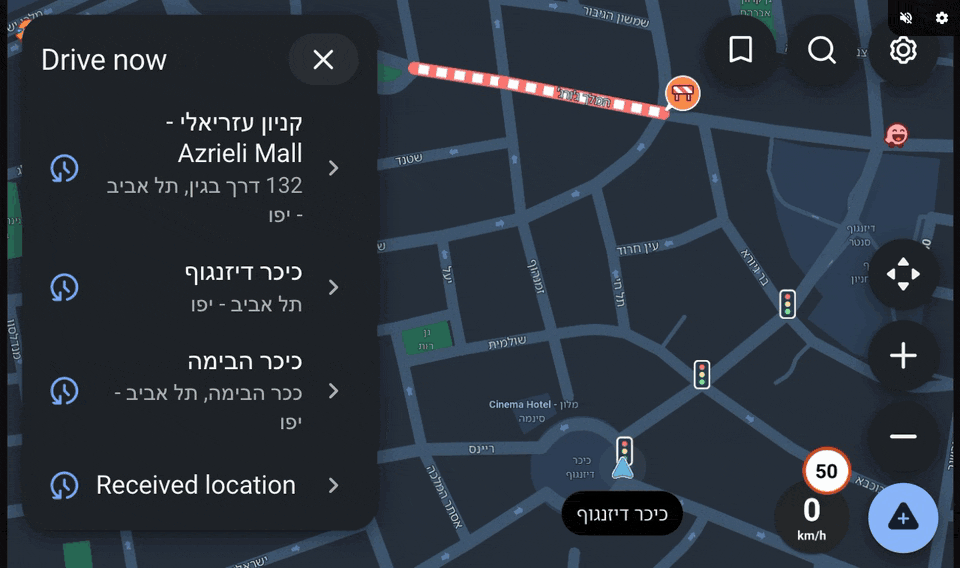
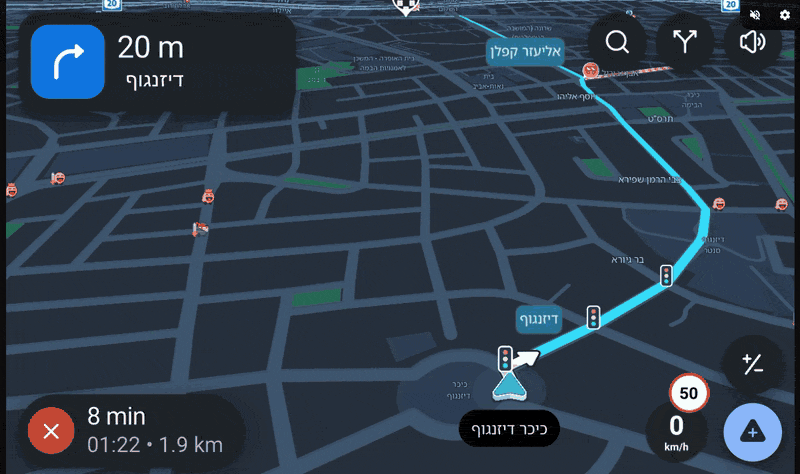
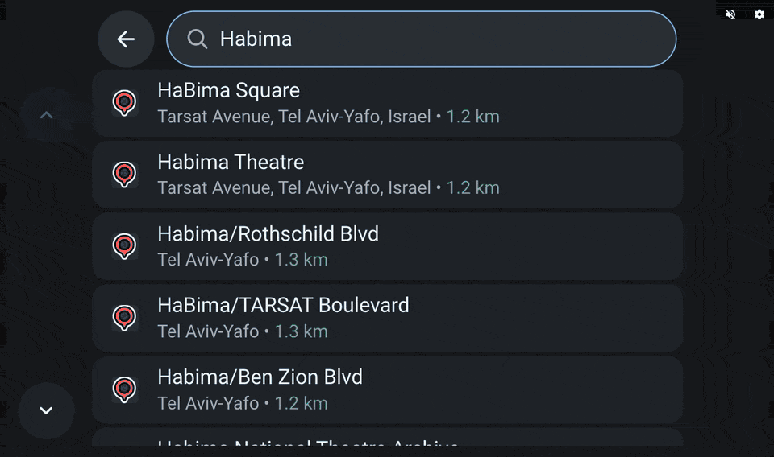
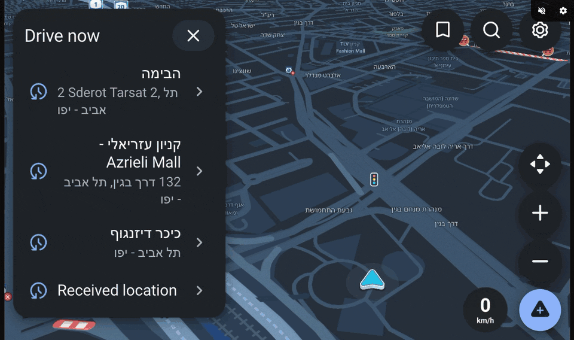
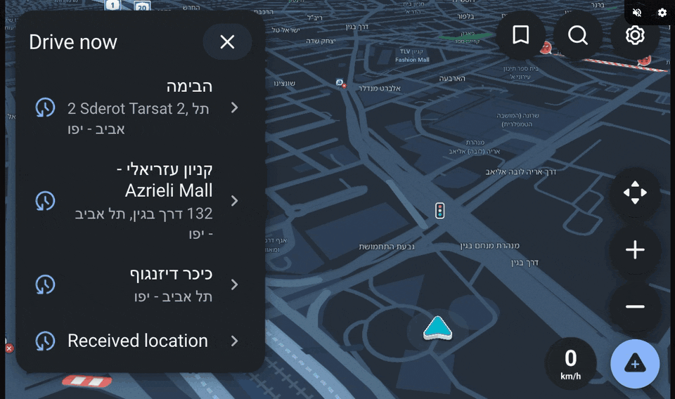
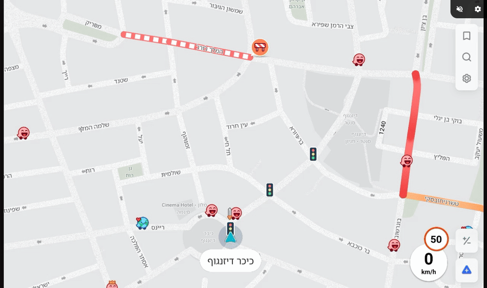
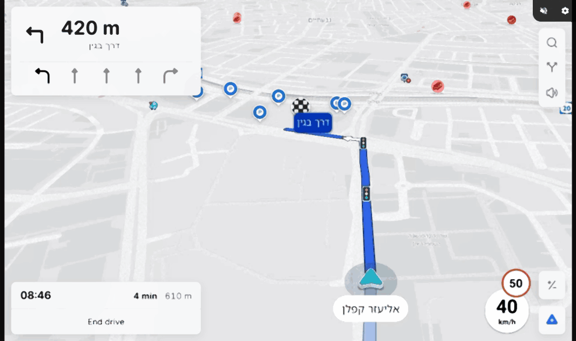
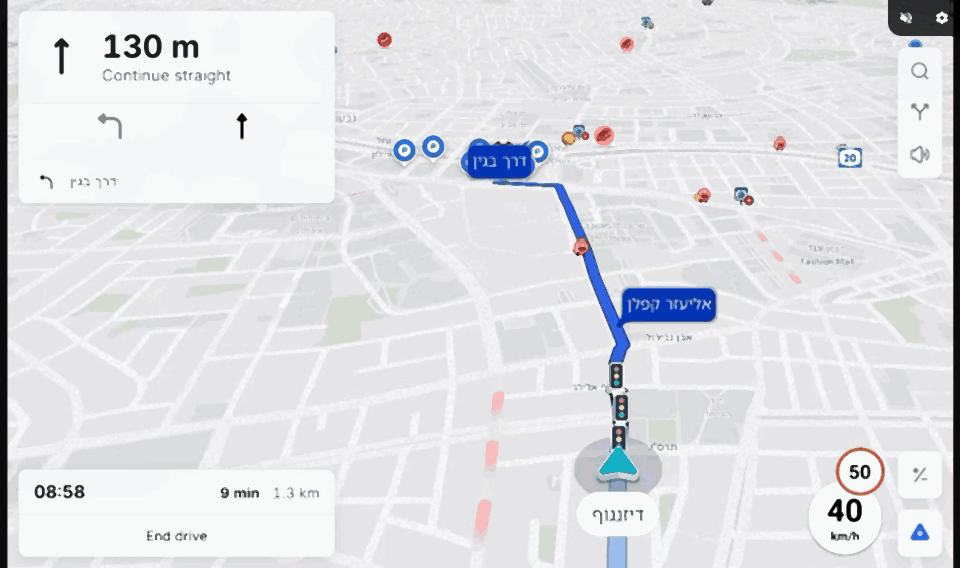

# Changelog

All notable changes to teslalinux, newest first. The format follows
[Keep a Changelog](https://keepachangelog.com/en/1.1.0/) and the versions follow
[Semantic Versioning](https://semver.org/).

<!--
This file is the one source of the release notes:
- the car page's Release Notes (web/js/release-notes/release-notes-data.js) are generated from it by
  `python3 tools/changelog/changelog.py page`, and tools/debvm/pack-dist.sh refuses to pack a stale
  copy;
- the GitHub Release of a tag v* is the section of that version (.github/workflows/release.yml).
Each "### Topic" is one card on the car page; its first line, in italics, is the card's subtitle.
"### Platform" is for developers and stays off the car page. Images are shown on GitHub only.
Date a version's heading ("- YYYY-MM-DD" instead of "- Unreleased") when its tag is pushed.
-->

## [0.2.0] - 2026-11-12

The car interface: in Car mode Waze shows the screens it was made for car displays, drawn by the car
page in large, rounded panels over Waze's own map. Phone mode (Waze as on a phone) stays the default.

### Car interface

*Waze's car screens, drawn in the car's browser.*

Settings > Waze interface > Car starts Waze without its phone screens. Waze then draws only its map,
and sends every other screen the way it does to a car display; the car page draws them over the map
in its own rounded dark style, sized for a touch screen at arm's length.

- Driving: a turn card with the maneuver, the distance, the road name and the lanes, and the step
  after it ("Then"); the trip estimate (minutes, arrival time, distance) with a button to end the
  drive; Waze's spoken prompts as before.
- Before driving: the Drive now panel with recent places, saved places behind the bookmark
  button, and search with live results as
  you type; the place card (opening hours, rating, address, distance); the route preview with
  alternate routes and their times, and Go now with its countdown.
- Waze's car settings, lists with sections, switches and choices, paging on long lists, alerts
  and short messages, the map buttons (zoom, recentre) folded into one ± button over the bare map,
  and the next step as a small pill when a panel covers the turn card.
- While the car moves, as on any car display: long lists are shortened and typing in search is
  turned off (Waze's own driving restrictions, from the car's speed).
- Day and night: the map turns dark after sunset at the car's position and light again in the
  morning.
- Touches on the map still reach Waze directly: drag, pinch and tap work as in Phone mode.

### Graphite, a second look for the car interface

*Settings > Waze interface > Car interface style.*

Rounded (the default) keeps the dark rounded panels. Graphite is flat and quieter: frosted panels,
light by day and dark by night, in the Inter typeface.

- Driving: one turn card with the lanes and the step after it, and a trip card with the arrival
  time, the minutes and distance left, and End drive.
- The map buttons stand in slim frosted columns at the right edge; search opens as a card over the
  live map, with the keyboard under it; lists have thin dividers between rows.
- The choice is kept by the browser, like the display settings, and applies at once.

### Day and night

*Settings > Waze interface > Day and night.*

Automatic (the default) follows the sun at the car's position, as before; Day and Night fix it.
Waze's map follows the choice, and so do the Graphite panels: the car page now hears when the car
switches between day and night, at the same moment as Waze.

### Map colours

*Settings > Waze interface > Map colours, with Graphite.*

- Graphite: Waze draws its map in Graphite's own palette (neutral land and roads, the route in
  Graphite's blue), day and night. Waze's files are never changed: when Waze starts, it is handed a
  recoloured copy of its colour file in memory, and only for Waze versions verified with this
  palette (today 5.25.0.1). For any other version Settings says so and the map falls back to Muted.
  Switching Graphite on or off restarts Waze.
- Muted (the default) shows Waze's map in calm neutral greys with the route in Graphite's blue, by
  day and by night; traffic, speed limits, report pins and the speedometer keep their colours. Only
  the car page's picture changes.
- Waze's own shows the map exactly as Waze draws it.

Phone mode always shows Waze's own colours.

### Smaller fixes

*Things that were in the way.*

- In Car mode, the page's mute and settings buttons no longer cover the top of Waze's buttons at
  the top right: those now start just below them.
- The notice about a temporary certificate no longer covers the first buttons of the bottom bar on
  the app pages, and in Car mode it sits at the bottom centre, clear of End drive.

### Phone or Car, your choice

*Settings > Waze interface.*

Phone is the default. Switching restarts only Waze (a few seconds; your places and settings are the
same in both), and every open car page follows the change by itself.

### Release notes in the car

*This page now shows Teslalinux's own releases.*

The Release Notes page used to show the history of Tesla Android, the project Teslalinux is forked
from. It now lists Teslalinux's releases, generated from the project's changelog (CHANGELOG.md).

### Known issues

*What does not work yet.*

- Waze 5.25 sends no arrival screen: at the destination the drive simply ends and the map comes
  back, without the arrival summary some car displays show.
- Waze keeps redrawing its map while nothing moves, so the display stream sends frames even when
  the picture is still (more CPU and Wi-Fi use than needed).
- In Phone mode, the Account and login screen does not scroll.
- Some outlines drawn by the app may be missing: Paint.getFillPath (stroke to outline) is not
  implemented yet.
- With the Rounded look, the panels keep their dark style in daytime; only the map and its buttons
  switch to day colours (Graphite switches its panels too).
- Muted map colours need the h264 renderer (Settings > Display > Renderer); with MJPEG the map keeps
  Waze's own colours.

### Platform

#### Added

- Car-app host in ATL (fork commit `6a7d2920`, enabled by the launcher in Car mode): binds the app's
  `CarAppService`, handshakes at API level 9, gives the app a map surface sized to the free area the
  car page reports, answers constraints, vehicle data and day/night, and sends every template as JSON
  on `/sockets/carapp` (port 9995 behind nginx); the car page sends back clicks, selections,
  toggles, search, back and map gestures. `ATL_CAR_DAY_NIGHT=day|night` or a `dayNight` message
  overrides the sun. Documented in `docs/UPSTREAM-NOTES.md`, "Car app templates"; the upstream
  protocols are unchanged.
- `web/js/carapp/`: the renderer (`carapp-renderer.js`), the channel (`carapp-controller.js`),
  `carapp.css`, `host-style.json` (sizes taken from the AOSP Templates Host by
  `tools/carhost/host-style.py`) and `test.html` with sample templates; a Material Symbols subset
  for the maneuver glyphs.
- `--background` start in ATL: the app starts without an activity (Application and providers
  only), as Android does for a service binding.
- Android platform pieces in the fork: system apps from `system/{app,priv-app}` with privapp
  allowlists; a uid per package and the platform as uid 1000; Binder calling identity across any
  number of parties; permission checks per uid; `createPackageContext` per package; `android.car`
  (Car, CarAppFocusManager, CarDrivingStateManager, CarUxRestrictionsManager,
  CarNavigationStatusManager) backed by ATLCarService; SurfaceControl, SurfaceControlViewHost and
  SurfacePackage with embedded windows; a real ServiceManager; services with AOSP semantics (bind,
  unbind, rebind, start ids); virtual displays; a platform signature made at build time.
- Settings > Waze interface: `GET/POST /api/appInterface`, the root helper
  `host/teslalinux-set-app-interface` (one sudoers rule), and `TESLALINUX_APP_INTERFACE` in the
  launcher (`--background`, `ATL_CAR_HOST`, `ATL_IS_AUTOMOTIVE`).
- `tools/carhost/`: a reproducible build of the AOSP Templates Host (pinned commit and checksums)
  with its privapp allowlist, for the system-app path.
- `tools/debian/atl-tests/`: runtime tests for services, calling identity, the platform package,
  virtual displays, system apps, uids, permissions and SurfaceControlViewHost embedding (84 checks
  plus a GTK embedding test); `docs/ARCHITECTURE.md` section 4.7.
- `CHANGELOG.md` and `tools/changelog/changelog.py`: the car page's release notes and the GitHub
  Release body are generated from this file; `pack-dist.sh` refuses stale release notes.
- `docs/media/`: the GIFs above.
- The car-app host tells the car page the car's night mode, `{"type":"dayNight","night":B}` on
  `/sockets/carapp` (state: a page that connects later gets it too); the page sends the driver's
  choice back as `{"type":"dayNight","mode":"auto|day|night"}`.
- The Graphite look in `web/js/carapp/` (`carapp.css`, `carapp-renderer.js`), with Inter (SIL OFL,
  `web/fonts/Inter-*-car.woff2`, subsets), and `web/js/display/map-tone.js`: the muted map colours
  as a pass in the h264 renderers' WebGL draw (WebCodecs and Broadway).
- File overlays (ATL `ATL_FILE_OVERLAYS=<manifest.json>`, `file_overlays.c`, a read-only open hook in
  bionic_translation): an app's read-only opens of a listed file get an in-memory copy with text
  replacements, only when the package, versionCode and the file's sha256 match a verified entry;
  writes always reach the real file. `host/appstyle/waze-map-graphite.json` is the Graphite map
  palette with its verified versions; `tools/appstyle/mapskin.py check|add|preview` and
  `docs/MAP-COLOURS.md` describe how to verify a new Waze version. The API reports whether the
  installed version is supported.

#### Changed

- ATL pinned to `6a7d2920` (from `125a433c`).
- New runtime package `webp-pixbuf-loader` (app icons in WebP) on Raspberry Pi OS, the Alpine image
  and the development VMs.
- The release workflow uses this changelog's section of the pushed tag as the release notes, with
  the GIFs linked at the tag.

#### Fixed

- VectorDrawable: `android:fillType="evenOdd"` (outlines with holes were filled solid) and gradient
  fills and strokes (drawn as one colour), as AOSP draws them.
- `IntentFilter.match` ignored an action mismatch; installed and system APK manifests were read
  from the wrong file; `queryIntentServices` fell back to the app's own services.

## [0.1.2] - 2026-11-11

### Certificate updates in a few bytes

*The Pi downloads the car's certificate only when it changes.*

The issuer publishes a small DNS record with the fingerprints of the current certificates. The Pi
checks it every hour (about 200 bytes instead of 11 KB every 6 hours) and downloads only a slot
that changed, verified exactly as before. A full download still happens at most every 6 hours as a
fallback, and whenever the served certificate is in the last quarter of its life.

### LTE that recovers by itself

*A stuck LTE stick is brought back without unplugging it.*

A Huawei E3372 (HiLink) that lost coverage often never reconnects until it is plugged in again.
When LTE has coverage but no internet for 90 seconds, the Pi now steps up one action at a time:
mobile data off and on, restart the stick, re-enumerate it on USB, and as a last resort power cycle
the USB port (by default only when the stick is the only USB device). At least 2 minutes between
steps, 15 minutes after a full round, and nothing at all without coverage, with a SIM problem,
while a preferred Wi-Fi works, or with `LTE_RECOVERY=off`. ModemManager modems get the same steps.

The car page's Status shows the stick: operator, network type, signal bars and radio values,
connection and roaming, data this session and this month, SIM problems and the last recovery
action.

### Waydroid is gone

*Waze runs under ATL on plain Raspberry Pi OS, nothing else.*

The old Android-container design (Waydroid, LXC, its network bridge and boot flags) is removed
from the installer, the services and the docs. There is no Android image and no container on the
Pi.

### Platform

#### Added

- `host/tls/renew.sh` keeps the TXT record `_car-certs.alexahub.dev`
  (`v=1 active=<slot> current=<sha256> standby=<sha256> t=<time>`) through the Cloudflare API;
  `teslalinux-tls fetch` reads it with `delv` (DNSSEC-validated where the zone is signed, `dig` as
  fallback) and treats the answer as untrusted: it only decides whether to download. New runtime
  package `bind9-dnsutils`. Design and threat model: `docs/CAR-STACK-READINESS.md`, section 4.
- `teslalinux-uplink`: the recovery ladder through the stick's HiLink API, sysfs and `uhubctl`
  (new runtime package), or NetworkManager/mmcli for ModemManager modems; the stick's status in
  `/api` for the car page.

#### Changed

- `docs/ARCHITECTURE.md` rewritten for the system as it is (data path, ATL, host, network,
  certificate, app updates, install and releases); README and service docs updated.
- `provision.sh` enables `teslalinux-atl.service`; the display script restarts the compositor
  instead of editing container properties.

#### Removed

- `android/` (container properties, package trim, first-boot bake), `waydroid-session.service`,
  the lxc/waydroid/gbinder packages, the veth/bridge modules, the container subnet masquerade in
  nftables and the container-only boot flags (cgroup, psi).

#### Fixed

- `install.sh` no longer drops every `LTE_*` setting from the configuration, only those that
  belong in `lte.env`.
- The certificate workflow's staging runs succeed when their issuances do (they publish nothing).

## [0.1.1] - 2026-11-11

### One address for every car

*https://car.alexahub.dev/ works out of the box.*

The Tesla browser opens only pages with a publicly trusted certificate, and the connection ends on
the Pi. Every Pi now serves the same certificate for `car.alexahub.dev` (as Tesla Android does with
its images), renewed automatically by this project and kept up to date on the Pi without a new
release. A new installation works in the car right away: the release carries the current
certificate. No per-device key, request or `--tls-key` option any more.

### Hebrew text and the compass

*Fixes in the app runtime.*

- Text in Hebrew (and other scripts) now uses Android's font fallback order, so it is drawn in
  Noto Sans Hebrew like on a phone.
- Waze's compass sometimes drew empty after a size change; views are now invalidated when their
  size changes, as on Android.

### Platform

#### Added

- `.github/workflows/tls-certs.yml` and `host/tls/renew.sh`: every 3 hours two slots, `current` and
  `standby`, are checked; a slot that is missing, revoked or due gets a fresh P-256 key and a Let's
  Encrypt certificate over DNS-01 on Cloudflare, passes the Pi's own checks and is published to R2;
  `active.json` names the slot to serve.
- `host/tls/teslalinux-tls`: fetches both slots whenever the Pi is online, accepts a pair only if
  the key matches, the names are exact, the chain verifies and it is newer, installs it atomically
  and serves the active slot; self-signed only without any trusted pair.
- `pack-dist.sh` bundles the published pair in the release; `install.sh` installs it.

#### Changed

- ATL pinned to `125a433c` (from `f2e34a51`): fonts from Android's `fonts.xml` fallback chain for
  fontconfig, and AOSP `setFrame` invalidation on GTK size changes.
- The release workflow: every action is GitHub's own and pinned to a full commit SHA; the build
  job only reads, and a short publish job (gh CLI) is the only one allowed to write the release.

## [0.1.0] - 2026-11-11

### First public release

*Waze in the Tesla browser, from a Raspberry Pi 4 running plain Linux.*

The car joins the Pi's Wi-Fi hotspot and opens the car page. The page shows Waze's screen,
streamed by a small Wayland compositor, sends your touches back, and passes the car's GPS
position and Waze's sound between the car and the Pi. Waze runs under the Android Translation
Layer (Android's framework reimplemented on GTK 4 with a standalone ART runtime): no Android image,
no Google Play services, no container.

- Waze end to end: map, search with the on-screen keyboard or the car's keyboard, places, routes,
  turn-by-turn navigation with voice prompts, settings and dialogs.
- The car's GPS drives Waze's position, with the car's speed and heading.
- Sound: Waze's voice plays in the car's browser.
- Internet through a USB LTE stick, backup Wi-Fi or Ethernet, with the hotspot for the car.

### Install with one command

*Raspberry Pi OS Lite 64-bit, nothing compiled on the Pi.*

`install.sh` from the release sets up the hotspot, the LTE modem, the web page and Waze
(`--waze apkpure` downloads it, `--apk FILE` installs a bundle you downloaded), keeps a backup of
every system file it replaces, and can be run again at any time. Afterwards
`teslalinux doctor | status | rollback | uninstall`.

### Waze updates itself

*Daily checks, verified downloads, rollback.*

The Pi checks for a new Waze every day, downloads it only on unmetered connections (or over LTE if
you allow it), verifies that it carries Waze's original signature, and installs it when the car is
not connected or at the next boot, with a health check and an automatic rollback. You can also
upload an app bundle from the car page (Settings > App updates).

### The car page

*Tesla Android's page, as Teslalinux.*

The car page is Tesla Android's web app with Teslalinux's name and settings: Status, Display,
Wi-Fi and LTE, Audio, GPS, Language and region, Keyboard and App updates.

### Platform

#### Added

- `services/display/`: tacomp, a headless wlroots 0.20 compositor streaming JPEG or H.264 (V4L2
  M2M) on `:9091/sockets/display` and turning `:9999/sockets/touchscreen` into `wl_touch`.
- `services/gps/`, `services/audio/`, `services/api/`: browser geolocation to ATL's
  LocationManager, PipeWire to FLAC fMP4, and `/api/*` state and display reconfiguration. The
  upstream ports, frame formats and messages are unchanged (`docs/UPSTREAM-NOTES.md`).
- The ATL fork (`Alexa-RR/android_translation_layer`, pinned at `f2e34a51`: upstream merged up to
  `45e675b8`) with everything Waze needs, built by `tools/debvm/build-dist.sh` and released as a
  prebuilt runtime by `.github/workflows/release.yml` on an arm64 runner (Debian trixie).
- `tools/pios/install.sh`, `tools/apps/` (installs the original signed split APKs, checks signer
  and versionCode, keeps the previous version), `tools/appupdate/` (`tlplay`, `teslalinux-appupdate`).
- The Alpine image (`tools/image/`, `docs/ALPINE-IMAGE.md`), a second, experimental target.

[0.2.0]: https://github.com/Alexa-RR/teslalinux/compare/v0.1.2...v0.2.0
[0.1.2]: https://github.com/Alexa-RR/teslalinux/compare/v0.1.1...v0.1.2
[0.1.1]: https://github.com/Alexa-RR/teslalinux/compare/v0.1.0...v0.1.1
[0.1.0]: https://github.com/Alexa-RR/teslalinux/releases/tag/v0.1.0
